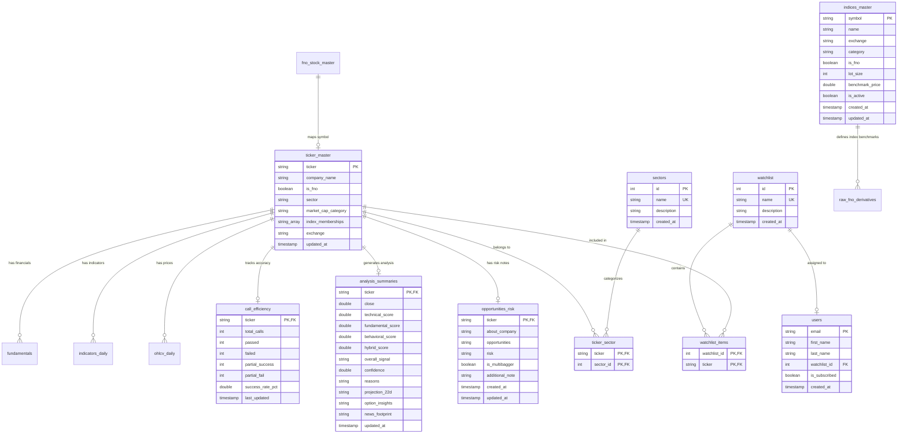

# Database Schema & Internal Relationships Documentation (`schema.md`)

This document provides a comprehensive technical reference for the PostgreSQL database (`bsa_db`) powering the BSA Screener application. It details table schemas, column data types, foreign key constraints, indexing strategies, and entity relationships across the multi-phase data analysis pipeline.

---

## 1. Architectural Overview & Data Management Flow

The database architecture is structured around strict separation between **Master Setup Data**, **Ingested Raw Market Data**, and **Engine-Generated Technical Scanners & Analysis Summaries**.

```
                           +------------------------+
                           |     system_config      |
                           +------------------------+
                                       |
  +------------------------------------+------------------------------------+
  |                                    |                                    |
  v                                    v                                    v
+------------------+         +--------------------+               +-------------------+
|  ticker_master   | <------ |   ticker_sector    | ------------> |      sectors      |
+------------------+         +--------------------+               +-------------------+
  |   |   |   |   \                                                         |
  |   |   |   |    +------------+                                           v
  |   |   |   +----------+      |                                 +-------------------+
  |   |   v              v      v                                 |  indices_master   |
  |   | +--------------+ +---------------+                        +-------------------+
  |   | | watchlist_items| |opportunities_risk|
  |   | +--------------+ +---------------+
  |   |        ^
  |   v        |
  | +--------------+     +---------------+
  | |  watchlist   | <-- |     users     |
  | +--------------+     +---------------+
  |
  +-------------------------------------------------------------+
  |                   |                    |                    |
  v                   v                    v                    v
+--------------+    +------------------+ +--------------+     +--------------------+
| ohlcv_daily  |    | indicators_daily | | fundamentals |     |analysis_summaries  |
+--------------+    +------------------+ +--------------+     +--------------------+
                                                                  |
                                                                  +-----> +----------------+
                                                                  |       |historical_calls|
                                                                  |       +----------------+
                                                                  |
                                                                  +-----> +----------------+
                                                                          |call_efficiency |
                                                                          +----------------+
```

### Data Pipeline Phases

1. **Phase 0 - Golden Master Setup**: Establishes clean master metadata (`ticker_master`, `indices_master`, `sectors`, `fno_stock_master`, `watchlist`, etc.).
2. **Phase 1 - Raw Ingestion**: Ingests price history (`ohlcv_daily`), quarterly metrics (`fundamentals`), and derivatives (`raw_fno_derivatives`) without prior technical calculation.
3. **Phase 2 - Technical Engine Analysis**: Computes technical indicators (`indicators_daily`) and populates multi-factor analysis summaries (`analysis_summaries`, `historical_calls`, `call_efficiency`).

---

## 2. Entity Relationship Diagram (ERD)



---

## 3. Table Catalog & Column Specifications

### 3.1 Master Setup & Configuration Tables

#### `indices_master`
Dedicated master registry for market indices (e.g. `NIFTY`, `BANKNIFTY`, `FINNIFTY`, `MIDCPNIFTY`, `NIFTYNXT50`, `SENSEX`, `BANKEX`).
- **`symbol`** (`TEXT`, PK): Index symbol identifier.
- **`name`** (`TEXT`, NOT NULL): Full index name (e.g. `Nifty 50 Index`).
- **`exchange`** (`TEXT`, DEFAULT `'NSE'`): Primary exchange (`NSE`, `BSE`).
- **`category`** (`TEXT`, DEFAULT `'BENCHMARK'`): Category (`BENCHMARK`, `SECTORAL`, `THEMATIC`, `STRATEGY`).
- **`is_fno`** (`BOOLEAN`, DEFAULT `TRUE`): Flag indicating if F&O derivatives exist for this index.
- **`lot_size`** (`INTEGER`, DEFAULT `25`): Contract lot size.
- **`benchmark_price`** (`DOUBLE PRECISION`): Reference benchmark price level.
- **`is_active`** (`BOOLEAN`, DEFAULT `TRUE`): Active tracking flag.
- **`created_at`**, **`updated_at`** (`TIMESTAMP`, DEFAULT `now()`).

#### `ticker_master`
Primary lookup directory for all registered stock symbols.
- **`ticker`** (`TEXT`, PK): Stock symbol (e.g., `RELIANCE`, `TCS`).
- **`company_name`** (`TEXT`, NOT NULL): Full legal corporate name.
- **`is_fno`** (`BOOLEAN`, DEFAULT `FALSE`): Flag indicating if the stock is part of the F&O segment.
- **`sector`** (`TEXT`): Primary sector classification string.
- **`market_cap_category`** (`TEXT`, DEFAULT `'Largecap'`): Cap classification (`Large Cap`, `Mid Cap`, `Small Cap`, `Micro Cap`, `SME`).
- **`index_memberships`** (`TEXT[]`, DEFAULT `'{}'`): Array of index memberships (e.g. `{"NIFTY", "NIFTY50"}`).
- **`exchange`** (`TEXT`, DEFAULT `'NSE'`): Primary exchange (`NSE`, `BSE`, `NASDAQ`).
- **`updated_at`** (`TIMESTAMP`, DEFAULT `now()`): Record modification timestamp.

#### `sectors`
Master registry for industrial and market sector categories.
- **`id`** (`SERIAL`, PK): Unique sector identifier.
- **`name`** (`TEXT`, UK, NOT NULL): Sector name (e.g., `Information Technology`, `Energy`).
- **`description`** (`TEXT`): Optional description of sector scope.
- **`created_at`** (`TIMESTAMP`, DEFAULT `now()`): Creation timestamp.

#### `ticker_sector`
Junction table mapping tickers to multiple sectors.
- **`ticker`** (`TEXT`, PK, FK -> `ticker_master.ticker` ON DELETE CASCADE).
- **`sector_id`** (`INTEGER`, PK, FK -> `sectors.id` ON DELETE CASCADE).

#### `watchlist`
User or system defined portfolio watchlists.
- **`id`** (`SERIAL`, PK): Unique watchlist identifier.
- **`name`** (`TEXT`, UK, NOT NULL): Watchlist name.
- **`description`** (`TEXT`): Optional description.
- **`created_at`** (`TIMESTAMP`, DEFAULT `now()`): Creation timestamp.

#### `watchlist_items`
Junction table containing items within watchlists.
- **`watchlist_id`** (`INTEGER`, PK, FK -> `watchlist.id` ON DELETE CASCADE).
- **`ticker`** (`TEXT`, PK, FK -> `ticker_master.ticker` ON DELETE CASCADE).

#### `users`
Registered application users.
- **`email`** (`TEXT`, PK): User email address.
- **`first_name`** (`TEXT`, NOT NULL): User first name.
- **`last_name`** (`TEXT`, NOT NULL): User last name.
- **`watchlist_id`** (`INTEGER`, FK -> `watchlist.id` ON DELETE SET NULL): Primary assigned watchlist.
- **`is_subscribed`** (`BOOLEAN`, DEFAULT `FALSE`): Newsletter/alert subscription status.
- **`created_at`** (`TIMESTAMP`, DEFAULT `now()`): Registration date.

#### `fno_stock_master` & `fno_index_master`
Derivative contract masters for stocks and indices.
- **`id`** (`SERIAL`, PK).
- **`symbol`** (`TEXT`, UK, NOT NULL): F&O contract symbol.
- **`underlying_name`** (`TEXT`, NOT NULL): Full underlying asset name.
- **`instrument_type`** (`TEXT`, DEFAULT `'STOCK'` / `'INDEX'`).
- **`is_active`** (`BOOLEAN`, DEFAULT `TRUE`): Active contract flag.
- **`entry_date`** (`TEXT`), **`exit_date`** (`TEXT`).

#### `opportunities_risk`
Fundamental Qualitative & Multibagger analysis notes.
- **`ticker`** (`TEXT`, PK, FK -> `ticker_master.ticker` ON DELETE CASCADE).
- **`about_company`** (`TEXT`), **`opportunities`** (`TEXT`), **`risk`** (`TEXT`).
- **`is_multibagger`** (`BOOLEAN`, DEFAULT `FALSE`).
- **`additional_note`** (`TEXT`).

#### `system_config` & `ticker_mappings` & `alternative_names` & `excluded_tickers`
- **`system_config`**: Key-value system configuration store (`key` PK, `value`).
- **`ticker_mappings`**: Historical symbol migration mapping (`old_ticker` PK, `new_ticker`).
- **`alternative_names`**: Data vendor ticker aliases (`data_ticker` UK, `current_ticker`).
- **`excluded_tickers`**: Logical exclusion layer for delisted/untracked tickers (`ticker` UK, `reason`, `status`).

---

### 3.2 Market Price, Indicator & Derivatives Data Tables

#### `ohlcv_daily`
Historical daily market price bar dataset.
- **`ticker`** (`TEXT`, PK), **`trade_date`** (`TEXT`, PK): Composite Primary Key (`ticker`, `trade_date`).
- **`open`**, **`high`**, **`low`**, **`close`** (`DOUBLE PRECISION`): OHLC prices.
- **`volume`** (`BIGINT`): Total traded share volume.
- **`vwap`** (`DOUBLE PRECISION`): Volume weighted average price.

#### `indicators_daily`
Computed daily technical indicators.
- **`ticker`** (`TEXT`, PK), **`trade_date`** (`TEXT`, PK).
- **`rsi14`** (`DOUBLE PRECISION`): 14-period Relative Strength Index.
- **`sma20`**, **`sma50`** (`DOUBLE PRECISION`): Simple Moving Averages.
- **`ema12`**, **`ema26`** (`DOUBLE PRECISION`): Exponential Moving Averages.
- **`macd_line`**, **`macd_signal`**, **`macd_hist`** (`DOUBLE PRECISION`): MACD indicators.
- **`bb_upper`**, **`bb_mid`**, **`bb_lower`** (`DOUBLE PRECISION`): Bollinger Bands.
- **`atr14`** (`DOUBLE PRECISION`): Average True Range.
- **`tenkan_sen`**, **`kijun_sen`**, **`span_a`**, **`span_b`** (`DOUBLE PRECISION`): Ichimoku Cloud metrics.

#### `fundamentals`
Quarterly financial ratios and growth evaluations.
- **`ticker`** (`TEXT`, PK), **`fetched_date`** (`TEXT`, PK).
- **`current_pe`**, **`avg_pe`**, **`last_pat`**, **`avg_pat`**, **`debt_to_equity`** (`DOUBLE PRECISION`).
- **`is_pat_growing`**, **`is_other_income_ok`**, **`is_pe_ok`**, **`is_debt_equity_ok`** (`INTEGER` 0/1).
- **`fundamental_score`** (`INTEGER`): Evaluated financial score.

#### `raw_fno_derivatives`
Daily strike-level derivative option chain snapshots.
- **`ticker`**, **`strike_price`**, **`option_type`** (`CE`/`PE`), **`expiry_date`** (`TEXT`): Composite PK.
- **`volume`**, **`ltp`**, **`underlying_price`**, **`last_updated`**.

#### `mf_holdings`
Quarterly domestic mutual fund & institutional holdings downloaded per stock.
- **`id`** (`SERIAL`, PK).
- **`ticker`** (`TEXT`, FK -> `ticker_master.ticker` ON DELETE CASCADE).
- **`fund_name`** (`TEXT`): Name of the mutual fund scheme or institution.
- **`holding_pct`** (`DOUBLE PRECISION`): Holding percentage (e.g. 2.76).
- **`shares_held`** (`BIGINT`): Quantity of shares held (if available).
- **`rank`** (`INTEGER`): Institutional holder rank by holding percentage.
- **`disclosure_date`** (`TEXT`): Disclosure quarter date (e.g. `'Dec 2024'`).
- **`downloaded_at`** (`TEXT`): ISO timestamp when downloaded.
- **`UNIQUE (ticker, fund_name)`**.

---

### 3.3 Engine Analysis Summaries & Scanner Reports

#### `analysis_summaries`
Consolidated multi-factor scoring and research summary matrix.
- **`ticker`** (`TEXT`, PK, FK -> `ticker_master.ticker` ON DELETE CASCADE).
- **`close`** (`DOUBLE PRECISION`): Latest close price.
- **`technical_score`**, **`fundamental_score`**, **`behavioral_score`**, **`hybrid_score`** (`DOUBLE PRECISION`).
- **`overall_signal`** (`TEXT`): Overall recommendation (`STRONG BUY`, `BUY`, `HOLD`, `SELL`, `STRONG SELL`).
- **`confidence`** (`DOUBLE PRECISION`): Signal confidence percentage (e.g. `85.0`).
- **`reasons`** (`TEXT`): Synthesized technical and fundamental thesis text.
- **`projection_22d`**, **`option_insights`**, **`news_footprint`** (`TEXT`).

#### `historical_calls` & `historical_call_bkp`
Tracked trade recommendations and target outcome audit logs.
- **`id`** (`SERIAL`, PK).
- **`ticker`** (`TEXT`, NOT NULL).
- **`recommended_call`** (`TEXT`), **`confidence`** (`DOUBLE PRECISION`), **`cmp`** (`DOUBLE PRECISION`).
- **`entry_price`**, **`stop_loss`**, **`target_price`** (`DOUBLE PRECISION`).
- **`status`** (`TEXT` DEFAULT `'OPEN'`), **`outcome`** (`TEXT` DEFAULT `'OPEN'`).
- **`final_cmp`**, **`min_cmp`**, **`max_cmp`** (`DOUBLE PRECISION`).

#### `call_efficiency`
Historical win-rate statistics aggregated per ticker.
- **`ticker`** (`TEXT`, PK, FK -> `ticker_master.ticker` ON DELETE CASCADE).
- **`total_calls`**, **`passed`**, **`failed`**, **`partial_success`**, **`partial_fail`** (`INTEGER`).
- **`success_rate_pct`** (`DOUBLE PRECISION`).

---

## 4. Foreign Key Constraints Matrix

| Source Table | Source Column | Target Table | Target Column | On Delete Action |
| :--- | :--- | :--- | :--- | :--- |
| `ticker_sector` | `ticker` | `ticker_master` | `ticker` | `CASCADE` |
| `ticker_sector` | `sector_id` | `sectors` | `id` | `CASCADE` |
| `watchlist_items` | `watchlist_id` | `watchlist` | `id` | `CASCADE` |
| `watchlist_items` | `ticker` | `ticker_master` | `ticker` | `CASCADE` |
| `users` | `watchlist_id` | `watchlist` | `id` | `SET NULL` |
| `opportunities_risk` | `ticker` | `ticker_master` | `ticker` | `CASCADE` |
| `analysis_summaries` | `ticker` | `ticker_master` | `ticker` | `CASCADE` |
| `call_efficiency` | `ticker` | `ticker_master` | `ticker` | `CASCADE` |

---

## 5. Performance Indexes

```sql
-- Sector and Watchlist Lookup Optimizations
CREATE INDEX IF NOT EXISTS idx_ticker_sector_sector_id ON ticker_sector(sector_id);
CREATE INDEX IF NOT EXISTS idx_watchlist_items_watchlist_id ON watchlist_items(watchlist_id);
CREATE INDEX IF NOT EXISTS idx_users_watchlist_id ON users(watchlist_id);

-- Time-Series Range Scan Indexes
CREATE INDEX IF NOT EXISTS idx_ohlcv_ticker_date ON ohlcv_daily(ticker, trade_date DESC);
CREATE INDEX IF NOT EXISTS idx_indicators_ticker_date ON indicators_daily(ticker, trade_date DESC);
CREATE INDEX IF NOT EXISTS idx_fno_ticker ON raw_fno_derivatives(ticker);
```
